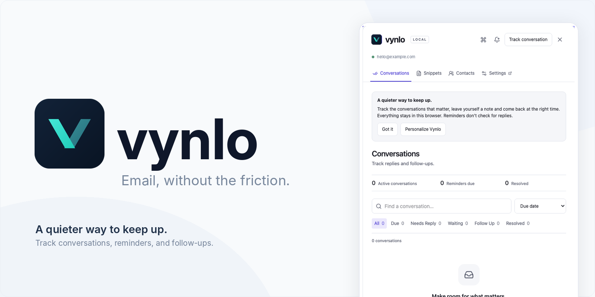

<picture>
  <source media="(prefers-color-scheme: dark)" srcset="assets/brand/marketing/vynlo-github-banner-dark.png" />
  
</picture>

_Brand illustration, not a verified Gmail screenshot._

# Vynlo

A free, open-source productivity layer for Gmail. Track conversations, remember follow-ups and write with reusable snippets, without leaving your inbox.

- Mark conversations **Needs Reply**, **Waiting**, **Follow Up** or **Resolved**.
- Schedule reminders and review what's due in one dashboard.
- Find actions through a command palette and configurable shortcuts.
- Insert snippets with template variables; keep contact notes and tags.
- Choose light or dark mode and export your workspace.

## Install locally

Use Chrome/Chromium 120+, Node.js 22.13.0+ and pnpm 11.9.0.

```sh
pnpm install --frozen-lockfile
pnpm build
```

1. Open `chrome://extensions` and enable **Developer mode**.
2. Select **Load unpacked**, then choose `.output/chrome-mv3` in this repository.
3. Reload Gmail and open Vynlo from its Gmail control.

Open a supported conversation and choose a status to start tracking. Use **Cmd+K** on macOS or **Ctrl+K** on Windows/Linux to open commands. Read the [usage guide](docs/USAGE.md) for reminders, snippets, shortcuts and data export.

After rebuilding, reload the extension and Gmail. Export your data before uninstalling or changing installation paths.

## Development

| Command         | Purpose                                  |
| --------------- | ---------------------------------------- |
| `pnpm preview`  | Open the live UI preview on port 4173    |
| `pnpm dev`      | Develop with WXT                         |
| `pnpm check`    | Formatting, lint, types, tests and build |
| `pnpm test:e2e` | Playwright fixture tests                 |
| `pnpm zip`      | Package the extension in `.output/`      |

See [development setup](docs/DEVELOPMENT.md), [architecture](docs/ARCHITECTURE.md) and [contributing](CONTRIBUTING.md). Vynlo uses TypeScript, React, WXT/Vite, Tailwind CSS, Lucide and Zustand.

## Privacy and compatibility

Your records stay in your browser profile. There is no Vynlo account, server, subscription or AI service. Vynlo never sends email, reads your entire mailbox or automatically detects replies. Local storage and JSON exports are not encrypted. Read the [privacy policy draft](docs/PRIVACY.md) and [security model](docs/SECURITY.md).

This release is a **compatibility preview**. Tracking works only when Gmail's visible conversation identity agrees with its route; unsupported or ambiguous views disable tracking. Fixture tests do not establish live Gmail compatibility. See [supported Gmail behavior](docs/GMAIL_COMPATIBILITY.md), [known limitations](docs/LIMITATIONS.md) and the [roadmap](docs/ROADMAP.md).

[MIT license](LICENSE) · [Contribute](CONTRIBUTING.md) · [GitHub](https://github.com/deBrian07/Vynlo) · [Release checklist](docs/RELEASE.md)
